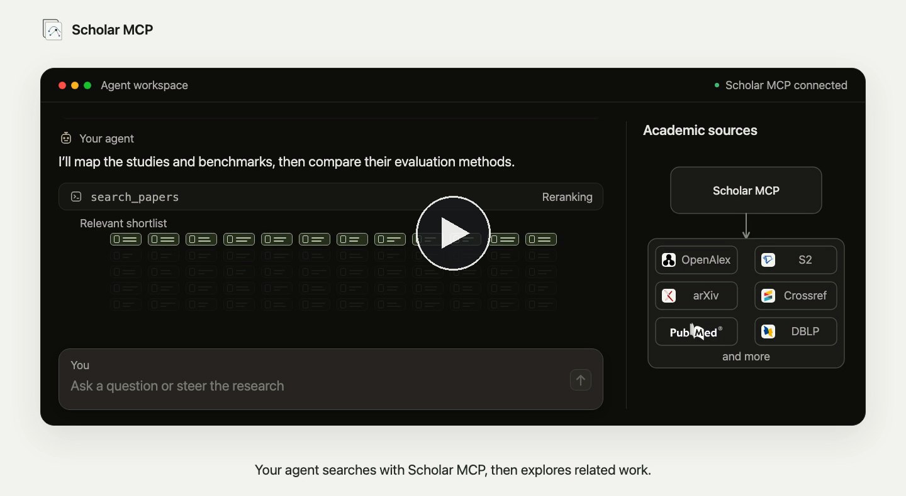
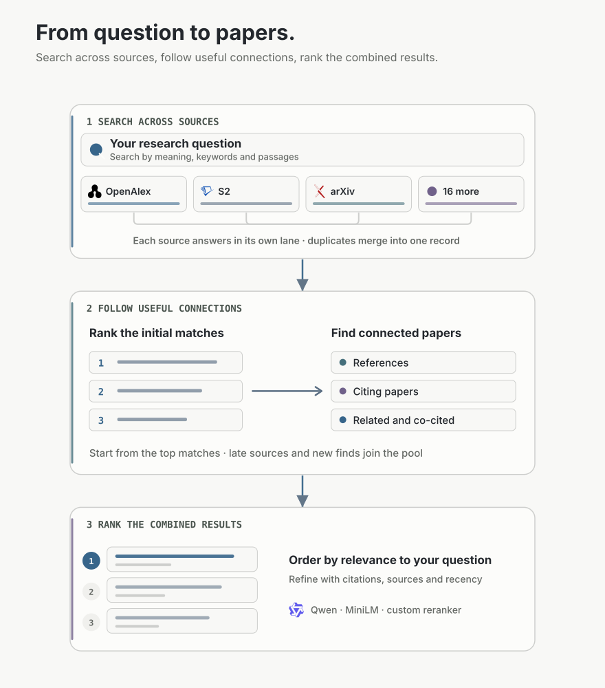
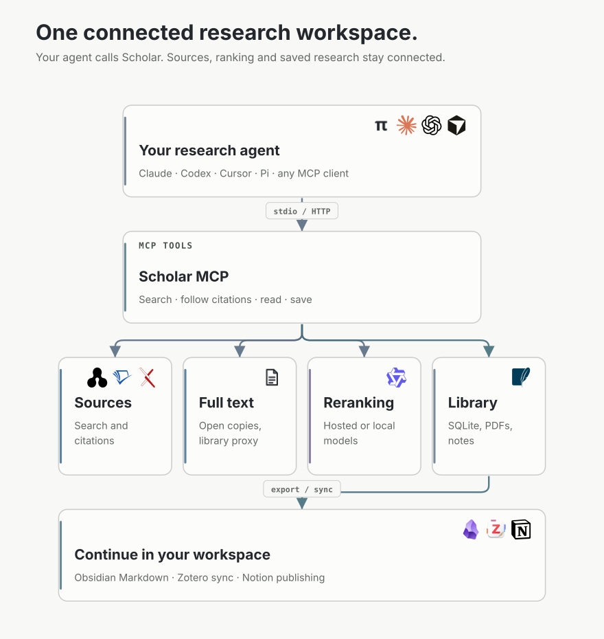
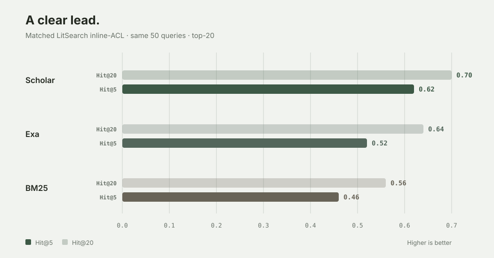
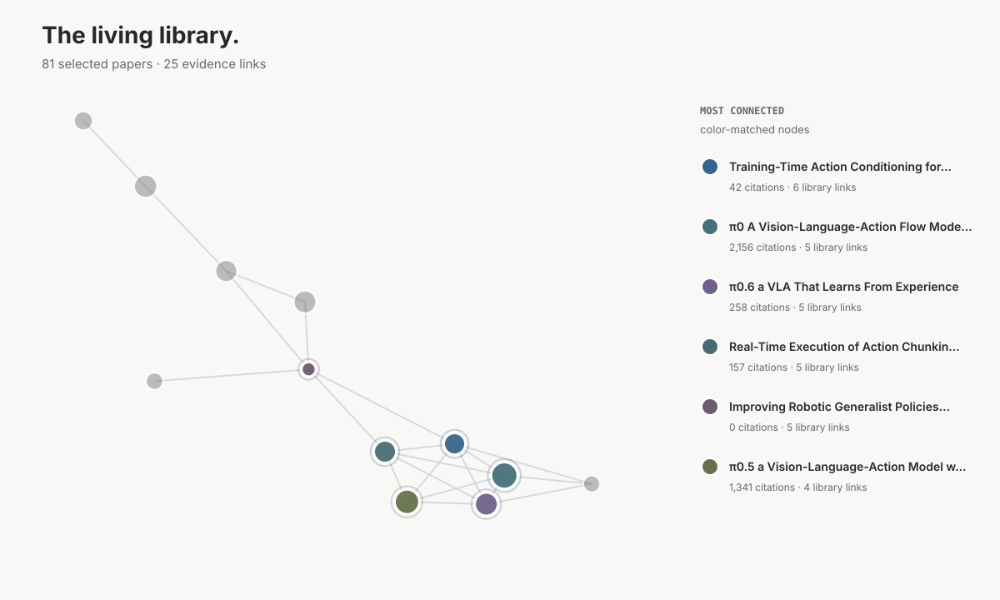

<!-- mcp-name: io.github.Liyux3/scholar-mcp -->

<p align="center">
  <picture>
    <source media="(prefers-color-scheme: dark)" srcset="docs/assets/scholar-mcp-logo-dark.svg">
    <source media="(prefers-color-scheme: light)" srcset="docs/assets/scholar-mcp-logo.svg">
    
  </picture>
</p>

<p align="center">
  <a href="https://vscode.dev/redirect/mcp/install?name=scholar-mcp&amp;config=%7B%22type%22%3A%22stdio%22%2C%22command%22%3A%22uvx%22%2C%22args%22%3A%5B%22--python%22%2C%223.12%22%2C%22--find-links%22%2C%22https%3A%2F%2Fgithub.com%2FLiyux3%2Fscholar-mcp%2Freleases%2Fdownload%2Fv0.9.0%2Fwheel-index.html%22%2C%22--from%22%2C%22scholar-mcp%5Brerank%5D%3D%3D0.9.0%22%2C%22scholar-mcp%22%5D%2C%22env%22%3A%7B%22SCHOLAR_MCP_EXTENSIONS%22%3A%22research%22%7D%7D"></a>
  <a href="cursor://anysphere.cursor-deeplink/mcp/install?name=scholar&amp;config=eyJzY2hvbGFyIjp7ImNvbW1hbmQiOiJ1dngiLCJhcmdzIjpbIi0tcHl0aG9uIiwiMy4xMiIsIi0tZmluZC1saW5rcyIsImh0dHBzOi8vZ2l0aHViLmNvbS9MaXl1eDMvc2Nob2xhci1tY3AvcmVsZWFzZXMvZG93bmxvYWQvdjAuOS4wL3doZWVsLWluZGV4Lmh0bWwiLCItLWZyb20iLCJzY2hvbGFyLW1jcFtyZXJhbmtdPT0wLjkuMCIsInNjaG9sYXItbWNwIl0sImVudiI6eyJTQ0hPTEFSX01DUF9FWFRFTlNJT05TIjoicmVzZWFyY2gifX19"></a>
  <a href="https://kiro.dev/launch/mcp/add?name=scholar-mcp&amp;config=%7B%22command%22%3A%22uvx%22%2C%22args%22%3A%5B%22--python%22%2C%223.12%22%2C%22--find-links%22%2C%22https%3A%2F%2Fgithub.com%2FLiyux3%2Fscholar-mcp%2Freleases%2Fdownload%2Fv0.9.0%2Fwheel-index.html%22%2C%22--from%22%2C%22scholar-mcp%5Brerank%5D%3D%3D0.9.0%22%2C%22scholar-mcp%22%5D%2C%22disabled%22%3Afalse%2C%22autoApprove%22%3A%5B%5D%2C%22env%22%3A%7B%22SCHOLAR_MCP_EXTENSIONS%22%3A%22research%22%7D%7D"></a>
  <a href="https://registry.modelcontextprotocol.io/?search=io.github.Liyux3%2Fscholar-mcp"></a>
  <a href="https://pypi.org/project/scholar-mcp"></a>
  <a href="LICENSE"></a>
</p>

<p align="center">
  Find the paper. Follow the evidence. Build the field.<br>
  <a href="https://liyux3.github.io/scholar-mcp/">Documentation</a> · English · <a href="README.zh-CN.md">简体中文</a>
</p>

Scholar MCP gives your AI agent a research library. It searches scholarly sources in parallel, with optional keys for additional indexes, follows citations and related work, reads the original paper down to its figures and tables, and keeps what matters in a local library with your notes. It works in Claude, Codex, Cursor, VS Code, Gemini CLI, OpenCode and any other MCP client, and from the command line or Python.

<p align="center">
  <a href="https://liyux3.github.io/scholar-mcp/#watch"></a>
</p>

## 📰 News

- October 2026, 0.9.0. `scholar-mcp install` sets Scholar up in 27 agents, one key file serves all of them, every source searches in its own lane, and `scholar-mcp doctor --network` checks every link.
- October 2026, 0.8.5. Google Scholar sessions recover on their own, and arXiv falls back to its own search when its API is down.

## 🚀 Get started

1. Install [uv](https://docs.astral.sh/uv/getting-started/installation/) if you do not have it, then install Scholar:

   ```bash
   uv tool install --python 3.12 --find-links https://github.com/Liyux3/scholar-mcp/releases/latest/download/wheel-index.html "scholar-mcp[rerank]"
   ```

2. Connect it to your agents. Scholar finds the clients on your machine and registers itself, with a backup of every file it touches:

   ```bash
   scholar-mcp install --all
   ```

   In a client the installer does not know, ask your agent to install Scholar by following [llms-install.md](llms-install.md). Name clients to choose (`scholar-mcp install claude-code codex`), add `--dry-run` to preview the change, or `--profile research` for the citation graph and paper library tools. `scholar-mcp update` upgrades the command every connected client runs, and `uvx scholar-mcp@latest install CLIENT` refreshes a client pinned to a uvx version.

3. Restart the client and ask a research question, for example *find recent work on evaluating long-term memory in LLM agents, read the most cited one and compare its benchmarks*.

<details>
<summary>Other ways to install</summary>

Any stdio MCP client can launch Scholar directly through uvx, with nothing installed in advance:

```json
{
  "mcpServers": {
    "scholar": {
      "command": "uvx",
      "args": [
        "--python", "3.12",
        "--find-links", "https://github.com/Liyux3/scholar-mcp/releases/latest/download/wheel-index.html",
        "--from", "scholar-mcp[rerank]", "scholar-mcp"
      ]
    }
  }
}
```

For Claude Code the same command is `claude mcp add scholar -- uvx --python 3.12 --find-links <index> --from 'scholar-mcp[rerank]' scholar-mcp`.

The repository is also a plugin marketplace for Codex and Claude Code, bundling the research tools and the Deep Research skill:

```bash
codex plugin marketplace add Liyux3/scholar-mcp && codex plugin add scholar-mcp@scholar-mcp
claude plugin marketplace add Liyux3/scholar-mcp && claude plugin install scholar-mcp@scholar-mcp
```

Releases also ship macOS desktop bundles (MCPB) with Python included, a multi-architecture container at `ghcr.io/liyux3/scholar-mcp`, and the [MCP Registry](https://registry.modelcontextprotocol.io/?search=io.github.Liyux3%2Fscholar-mcp) entry. See the [distribution matrix](docs/DISTRIBUTION.md) and [llms-install.md](llms-install.md) for agents installing it themselves.

</details>

## 🧰 What your agent can do

| | Tool | |
|---|---|---|
| Search | `search_papers` | One question fans out to every source; duplicates merge into one record, the pool is reranked, and citations of the best matches are followed before the final ranking |
| Inspect | `paper_info` | Full metadata, citations and references of a paper in one call |
| Explore | `recommend_papers` | Semantic neighbours, co-cited peers and papers sharing references |
| People | `search_authors` | Author profiles, affiliations and metrics |
| Read | `read_paper` | Page-aware Markdown, structured tables and a focused image of any figure, read temporarily |
| Keep | `download_paper` | The PDF from open archives, repositories or your institution's library, filed in your library |
| Map | `build_paper_graph` | A citation graph with PageRank and bridge papers (research profile) |
| Remember | `paper_library` | Collections, notes, tags and full-text search, mirrored to Obsidian, Zotero or Notion (research profile) |

Every identifier Scholar returns, a paper URL, or an exact title can be passed back to any tool. Responses carry readable YAML for the model and structured data for the client; `scholar://status` reports the sources and reranker in use.

## 🧭 How it works

<picture>
  <source media="(prefers-color-scheme: dark)" srcset="docs/assets/retrieval-pipeline-dark.svg">
  <source media="(prefers-color-scheme: light)" srcset="docs/assets/retrieval-pipeline.svg">
  
</picture>

Semantic sources receive the whole question and keyword sources a compact query tuned per source. Each source answers in its own lane at the pace it allows, and a source that misses the first ranking still joins the final one. Records from OpenAlex, Semantic Scholar, arXiv, Crossref, OpenReview, PubMed, Europe PMC, DBLP, zbMATH, CORE, OpenAIRE, Google Scholar and others merge on shared DOIs, arXiv ids and titles, so each paper appears once with complementary metadata. A reranker (Qwen3 Rerank in the cloud, or a local model) orders the pool, the strongest matches pull in their citations and references, and the combined pool is ranked once more. The [architecture page](https://liyux3.github.io/scholar-mcp/architecture/) walks through each stage and the [backend film](https://liyux3.github.io/scholar-mcp/architecture/#film) follows one question through it in two and a half minutes.

<details>
<summary>Runtime architecture</summary>

<picture>
  <source media="(prefers-color-scheme: dark)" srcset="docs/assets/runtime-architecture-dark.svg">
  <source media="(prefers-color-scheme: light)" srcset="docs/assets/runtime-architecture.svg">
  
</picture>

Agents call typed MCP tools over stdio or Streamable HTTP. Full text comes from open copies first and, for licensed papers, through your library's proxy. A persistent SQLite library with FTS5 search holds papers, notes and PDF attachments under `~/.scholar-mcp/`, with Markdown projections for Obsidian and connectors for Zotero and Notion.

</details>

## 📊 Measured retrieval quality



On the same 50 LitSearch queries, Scholar placed a correct paper in its top five for 62% of queries, against 52% for Exa research-paper search and 46% for BM25.

<details>
<summary>Results and protocol</summary>

| System | Hit@5 | Hit@10 | Hit@20 | MRR |
|---|---:|---:|---:|---:|
| Scholar | 0.62 | 0.68 | 0.70 | 0.442 |
| Exa `research paper` | 0.52 | 0.58 | 0.64 | 0.435 |
| BM25 `title + abstract` | 0.46 | 0.46 | 0.56 | 0.335 |

Hit@k is the share of queries with at least one ground-truth paper in the top k; MRR averages the reciprocal rank of the first match. Scholar recovered nine top-five hits that Exa missed, and Exa four that Scholar missed. The comparison uses the first 50 LitSearch inline-ACL queries, the same title matcher and a top-20 cutoff; Scholar ran its standard pipeline with Qwen reranking, Exa used category `research paper`, and BM25 follows the official LitSearch title+abstract implementation over the 64K-paper corpus. The frozen summary is in [`docs/benchmarks/litsearch-inline-acl-50.json`](docs/benchmarks/litsearch-inline-acl-50.json), with [raw BM25 results](docs/benchmarks/bm25_title_abstract_inline_acl_50.jsonl) and their [hash manifest](docs/benchmarks/bm25_title_abstract_inline_acl_50.summary.json).

</details>

## 📚 Your paper library



Saved papers, PDFs and notes live in one local SQLite library and stay searchable across sessions. Obsidian receives a live Markdown projection, Zotero a synchronized collection and Notion a reading list. Notes you edit in Obsidian or Notion flow back, so your agent builds on your changes.

```bash
scholar-mcp library export obsidian --collection memory --path ~/Vault
scholar-mcp library sync zotero --collection memory --apply
```

## 💻 Command line and Python

The tools work without an agent too. Output is YAML for reading or JSON with `--json`.

```bash
scholar-mcp search "long-term memory benchmarks for LLM agents" --year 2024-2026
scholar-mcp read arXiv:2504.19413 --pages 1-4
scholar-mcp read arXiv:2504.19413 --visual "Figure 1" --image figure1.png
scholar-mcp doctor --network
```

```python
from scholar_mcp import api

hits = api.search("long-term memory benchmarks for LLM agents", year="2024-2026")
paper = api.info(hits["results"][0]["id"], include="detail,citations")
```

## 🔑 Configuration

Scholar works without any keys. Optional keys add coverage and throughput. `scholar-mcp keys set NAME` saves one in `~/.scholar-mcp/keys.env`, which every client reads; a client's `env` block or your shell also works and takes precedence.

| Variable | Effect |
|---|---|
| `S2_API_KEY` | Higher Semantic Scholar limits, full-text snippets and recommendations |
| `OPENALEX_API_KEY`, `OPENALEX_EMAIL` | OpenAlex semantic search and the polite pool; the email also enables Unpaywall |
| `DASHSCOPE_API_KEY` | Cloud reranking with Qwen3 Rerank; without it a local model ranks |
| `SCHOLAR_MCP_EXTENSIONS=research` | Adds the citation graph and paper library tools |
| `SCHOLAR_DATA_DIR` | Library, PDFs and state; default `~/.scholar-mcp` |

<details>
<summary>All settings</summary>

| Variable | Purpose |
|---|---|
| `SCHOLAR_KB_DIR`, `SCHOLAR_DOWNLOAD_DIR` | SQLite library and persistent PDF directories |
| `SCHOLAR_OBSIDIAN_VAULT` | Obsidian projection root |
| `S2_API_KEYS`, `OPENALEX_API_KEYS` | Comma-separated key pools |
| `NCBI_API_KEY` | Higher PubMed E-utilities throughput for a configured NCBI account |
| `SCHOLAR_GOOGLE_PROXY` | A dedicated Google Scholar proxy, or `direct` to bypass inherited proxies for this source |
| `SCHOLAR_ACCESS_COMMAND` | Optional host access backend, a JSON command array; see [architecture](docs/ARCHITECTURE.md#host-access) |
| `SCOPUS_API_KEY`, `CORE_API_KEY`, `EXA_API_KEY` | Optional Scopus, CORE and Exa sources |
| `OPENAIRE_CLIENT_ID`, `OPENAIRE_CLIENT_SECRET` | A free registered OpenAIRE service: 7,200 requests an hour instead of 60 |
| `ADS_API_TOKEN`, `SPRINGER_API_KEY`, `WOS_API_KEY`, `LENS_API_TOKEN` | Opt-in NASA ADS, Springer Nature, Web of Science Starter and Lens sources, each joining once its key is set |
| `DASHSCOPE_HTTP_BASE_URL` | Alibaba workspace API host or `/api/v1` base; default is the Beijing shared endpoint |
| `SCHOLAR_RERANK_MODEL` | Alibaba model (default `qwen3-rerank`) or the model of a custom endpoint |
| `SCHOLAR_RERANK_URL`, `SCHOLAR_RERANK_API_KEY` | Full custom rerank endpoint (Cohere-style `query, documents, top_n` request) and its credential |
| `SCHOLAR_RERANK_TIMEOUT`, `SCHOLAR_RERANK_BATCH_SIZE` | Remote rerank timeout (120 s) and per-request document capacity (500) |
| `SCHOLAR_SOURCE_BUDGET_S` | Time budget of one parallel search round; default 30 s |
| `SCHOLAR_READ_CHAR_BUDGET` | Characters of paper text per `read_paper` response, cut at a page boundary; default 100,000, 0 disables |
| `SCHOLAR_USAGE_LOG` | Local call record in `<data>/usage/` (about 4 MB at most) that `doctor` summarizes: `on` (default, no query text), `full` (with arguments) or `off` |
| `SCHOLAR_GOOGLE_PROXY`, `SCHOLAR_GOOGLE_RECOVERY` | Google Scholar route and browser recovery mode (`off`, `headless`, `headed`) |
| `LIBRARY_PROXY_PREFIX`, `LIBRARY_PROXY_COOKIES` | Institutional EZproxy prefix and a cookies.txt from your signed-in browser |
| `ZOTERO_API_KEY`, `ZOTERO_LIBRARY_ID` | Zotero connector |
| `NOTION_API_KEY`, `NOTION_DATA_SOURCE_ID` | Notion connector |
| `SCHOLAR_MCP_TRANSPORT=http` | Streamable HTTP at `/mcp` instead of stdio (`scholar-mcp serve --http`) |
| `SCHOLAR_IDLE_EXIT` | HTTP idle exit in minutes, default `20`; `0` keeps the process running. A supervisor such as launchd KeepAlive restarts it to release loaded model memory. Active tool workers and streamed replies finish before the idle window starts. |

Scores from a custom reranker must be finite, in `[0, 1]` and comparable across batches; Scholar falls back to the local model when the endpoint fails and pauses retries for five minutes after a connection failure. Errors returned to the model redact URLs and credentials.

</details>

<details>
<summary>Paywalled papers and your institution's library</summary>

`download_paper` and `read_paper` look for free copies in parallel and prefer the publisher's version when one arrives. To use a paper your institution licenses, set its EZproxy prefix and a Netscape cookies.txt exported from your signed-in browser in the server's environment.

```bash
export LIBRARY_PROXY_PREFIX="https://proxy.library.example.edu/login?url="
export LIBRARY_PROXY_COOKIES="$HOME/private/library-cookies.txt"
```

Scholar reads only cookies scoped to that proxy. When the session expires, sign in through your browser and export a fresh file. See [Institutional access](https://liyux3.github.io/scholar-mcp/institutional-access/) for client configuration and network routing.

</details>

<details>
<summary>Google Scholar</summary>

With Chrome, Edge or Chromium and ffmpeg installed, `scholar-mcp[google,rerank]` adds automatic verification recovery: a short-lived headless browser with a fresh profile establishes a session, then ordinary HTTP handles searches and pagination. Sessions are stored privately under `<data>/sessions/`. Set `SCHOLAR_GOOGLE_RECOVERY=off` to disable it.

</details>

## 🔧 Development

```bash
git clone https://github.com/Liyux3/scholar-mcp.git
cd scholar-mcp
uv sync --extra dev
uv run pytest            # unit tests; live API tests run with -m integration
```

A new source is one module in `scholar_mcp/sources/` plus one registry entry, and needs no new tool. `scholar-mcp doctor --network` probes every source, the ranking model and the PDF chain, and runs daily in CI. See [ARCHITECTURE.md](docs/ARCHITECTURE.md) for how the parts fit and [CONTRIBUTING.md](CONTRIBUTING.md) for changes, and report security issues through [SECURITY.md](SECURITY.md).

## 📝 Citation

If Scholar MCP supports your research, please cite it.

```bibtex
@software{li_scholar_mcp_2026,
  author  = {Li, Yuxian},
  title   = {Scholar MCP},
  year    = {2026},
  version = {0.9.0},
  url     = {https://github.com/Liyux3/scholar-mcp},
  license = {Apache-2.0}
}
```

## 📄 License

Apache License 2.0. Reuse is welcome; keep the [NOTICE](NOTICE) file and credit Scholar MCP in what you build, whether a person or an AI agent did the copying.

Bundled CPU reader weights are provided unchanged by [prithivida/FlashRank](https://huggingface.co/prithivida/flashrank) under CC-BY-SA-4.0, with their own attribution notice.
