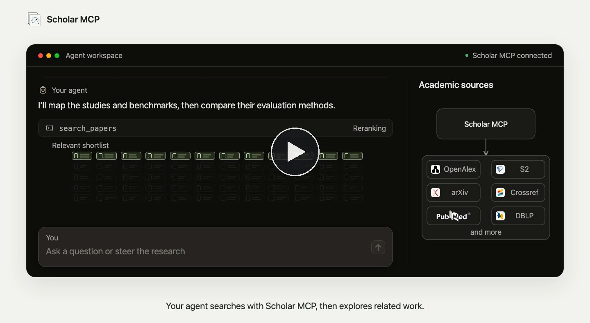
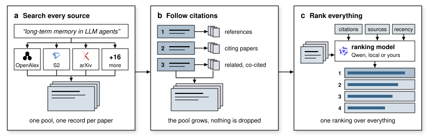
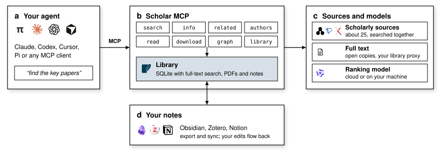
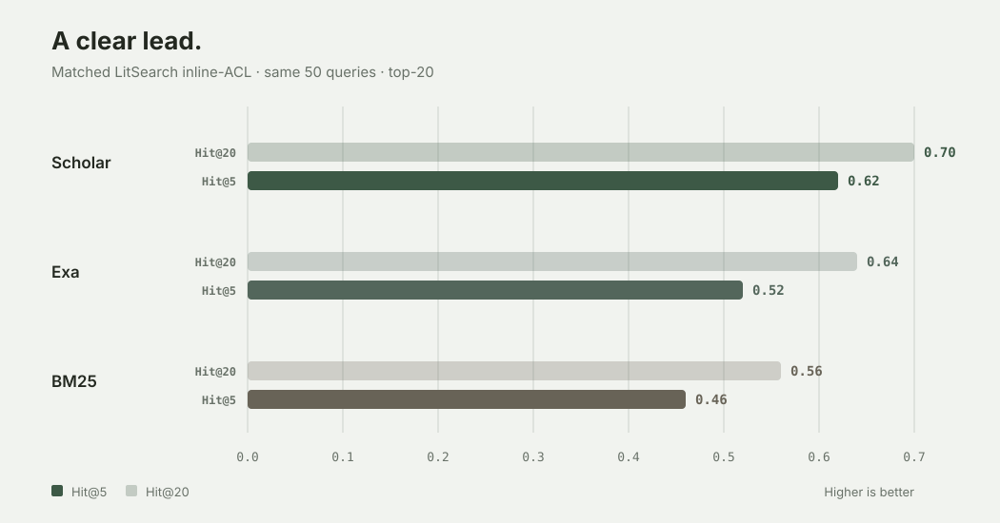
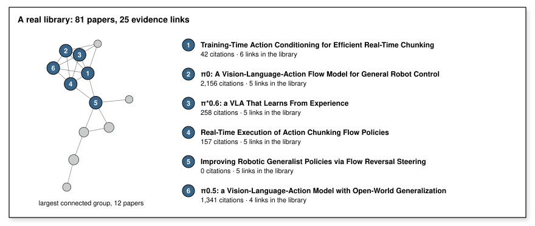

<p align="center">
  <picture>
    <source media="(prefers-color-scheme: dark)" srcset="docs/assets/scholar-mcp-logo-dark.svg">
    <source media="(prefers-color-scheme: light)" srcset="docs/assets/scholar-mcp-logo.svg">
    
  </picture>
</p>

<p align="center">
  <a href="https://vscode.dev/redirect/mcp/install?name=scholar-mcp&amp;config=%7B%22type%22%3A%22stdio%22%2C%22command%22%3A%22uvx%22%2C%22args%22%3A%5B%22--python%22%2C%223.12%22%2C%22--find-links%22%2C%22https%3A%2F%2Fgithub.com%2FLiyux3%2Fscholar-mcp%2Freleases%2Fdownload%2Fv0.11.0%2Fwheel-index.html%22%2C%22--from%22%2C%22scholar-mcp%5Brerank%5D%3D%3D0.11.0%22%2C%22scholar-mcp%22%5D%2C%22env%22%3A%7B%22SCHOLAR_MCP_EXTENSIONS%22%3A%22research%22%7D%7D"></a>
  <a href="cursor://anysphere.cursor-deeplink/mcp/install?name=scholar&amp;config=eyJzY2hvbGFyIjp7ImNvbW1hbmQiOiJ1dngiLCJhcmdzIjpbIi0tcHl0aG9uIiwiMy4xMiIsIi0tZmluZC1saW5rcyIsImh0dHBzOi8vZ2l0aHViLmNvbS9MaXl1eDMvc2Nob2xhci1tY3AvcmVsZWFzZXMvZG93bmxvYWQvdjAuMTEuMC93aGVlbC1pbmRleC5odG1sIiwiLS1mcm9tIiwic2Nob2xhci1tY3BbcmVyYW5rXT09MC4xMS4wIiwic2Nob2xhci1tY3AiXSwiZW52Ijp7IlNDSE9MQVJfTUNQX0VYVEVOU0lPTlMiOiJyZXNlYXJjaCJ9fX0="></a>
  <a href="https://kiro.dev/launch/mcp/add?name=scholar-mcp&amp;config=%7B%22command%22%3A%22uvx%22%2C%22args%22%3A%5B%22--python%22%2C%223.12%22%2C%22--find-links%22%2C%22https%3A%2F%2Fgithub.com%2FLiyux3%2Fscholar-mcp%2Freleases%2Fdownload%2Fv0.11.0%2Fwheel-index.html%22%2C%22--from%22%2C%22scholar-mcp%5Brerank%5D%3D%3D0.11.0%22%2C%22scholar-mcp%22%5D%2C%22disabled%22%3Afalse%2C%22autoApprove%22%3A%5B%5D%2C%22env%22%3A%7B%22SCHOLAR_MCP_EXTENSIONS%22%3A%22research%22%7D%7D"></a>
  <a href="https://registry.modelcontextprotocol.io/?search=io.github.Liyux3%2Fscholar-mcp"></a>
  <a href="https://pypi.org/project/scholar-mcp"></a>
  <a href="LICENSE"></a>
</p>

<p align="center">
  <a href="https://liyux3.github.io/scholar-mcp/zh-cn/">文档</a>&emsp;<a href="README.md">English</a>
</p>

Scholar MCP 让你的 AI 智能体自己查文献。它同时检索多个学术数据源，配上你自己的密钥还能多查几个索引，顺着引用和相关工作往下找，原文连图带表都能读，最后把有用的论文和你的笔记一起存进本地文献库。Claude、Codex、Cursor、VS Code、Gemini CLI、OpenCode 等 MCP 客户端都能接入，命令行和 Python 里也能直接用。

<p align="center">
  <a href="https://liyux3.github.io/scholar-mcp/zh-cn/#watch"></a>
</p>

## 📰 动态

- 2026 年 11 月，0.9.0 到 0.11.0。`scholar-mcp install` 一条命令接入 32 种智能体，某个数据源卡住时不再拖慢整次搜索，时间范围可以细到月和日，结果附完整摘要，搜知名学者也不会再找错人。
- 2026 年 7 月，0.8.5。Google Scholar 的会话失效后能自动恢复，arXiv 接口挂了就改走它的网页搜索，新增的 `scholar-mcp sources --check` 可以实时检查每个数据源。
- 2026 年 4 月，0.8.2 到 0.8.4。请求 Semantic Scholar 时遵守官方的限速建议，在 MCP Registry 上可以用 `io.github.Liyux3/scholar-mcp` 找到它，每个工具的说明都写清了适用场景。

<details>
<summary>更早的动态</summary>

- 2026 年 2 月，0.8.0 和 0.8.1。定下六个核心工具，并接入可以长期保存的文献库；有了插件和便携启动器，更多智能体客户端也能用上 Scholar。
- 2025 年 7 月，0.7.1 和 0.7.2。数据源被限流时会明确报出来，而不是看上去查无结果；单个慢数据源不再卡住整次搜索；arXiv 论文的引用图谱和相关论文推荐恢复正常。
- 2025 年 5 月，0.6.0 和 0.7.0。有了文献库，论文和笔记可以按合集保存；相关性模型给全部候选统一排序，最相关的结果会顺带找回它们的引用；新增 Europe PMC、INSPIRE-HEP 和 DBLP 三个数据源。
- 2024 年 12 月，0.1.0 到 0.2.1。发布首个版本，一条命令接入 Claude Code 就能检索 Semantic Scholar；几天后又加入了 CORE 和 PubMed。

</details>

更多内容见[更新记录](CHANGELOG.md)。

## 🚀 开始使用

1. 先装好 [uv](https://docs.astral.sh/uv/getting-started/installation/)（已有可跳过），再安装 Scholar。

   ```bash
   uv tool install --python 3.12 --find-links https://github.com/Liyux3/scholar-mcp/releases/latest/download/wheel-index.html "scholar-mcp[rerank]"
   ```

2. 接入智能体。Scholar 会自动找到本机已装的客户端并完成注册，改动任何文件前都会先备份。

   ```bash
   scholar-mcp install --all
   ```

   遇到安装命令不认识的客户端，让智能体照着 [llms-install.md](llms-install.md) 自己装就行。也可以只装指定的客户端（`scholar-mcp install claude-code codex`），加 `--dry-run` 先预览改动，加 `--profile research` 会一并装上引用图谱和文献库。以后升级只要运行 `scholar-mcp update`，所有已接入的客户端会一起更新；某个客户端如果用 uvx 固定了版本，运行 `uvx scholar-mcp@latest install 客户端名` 即可刷新。

3. 重启客户端，问一个研究问题试试，比如“找几篇近期评估 LLM 智能体长期记忆的工作，读一下引用最多的那篇，比较它用的基准”。

<details>
<summary>其他安装方式</summary>

支持 stdio 的 MCP 客户端都可以通过 uvx 直接启动 Scholar，无需事先安装。

```json
{
  "mcpServers": {
    "scholar": {
      "command": "uvx",
      "args": [
        "--python", "3.12",
        "--find-links", "https://github.com/Liyux3/scholar-mcp/releases/latest/download/wheel-index.html",
        "--from", "scholar-mcp[rerank]", "scholar-mcp"
      ]
    }
  }
}
```

在 Claude Code 里，对应的命令是 `claude mcp add scholar -- uvx --python 3.12 --find-links <index> --from 'scholar-mcp[rerank]' scholar-mcp`。

本仓库也是 Codex 和 Claude Code 的插件市场，插件里包含研究工具和 Deep Research 技能。

```bash
codex plugin marketplace add Liyux3/scholar-mcp && codex plugin add scholar-mcp@scholar-mcp
claude plugin marketplace add Liyux3/scholar-mcp && claude plugin install scholar-mcp@scholar-mcp
```

每个版本还会发布内置 Python 的 macOS 桌面安装包（MCPB）和多架构容器镜像 `ghcr.io/liyux3/scholar-mcp`，并同步到 [MCP Registry](https://registry.modelcontextprotocol.io/?search=io.github.Liyux3%2Fscholar-mcp)。详见[分发说明](docs/DISTRIBUTION.md)；要让智能体自己安装，可以参考 [llms-install.md](llms-install.md)。

</details>

## 🧰 智能体能做什么

| | 工具 | |
|---|---|---|
| 搜索 | `search_papers` | 一个问题同时发给所有数据源，重复记录合并为一条；先整体排序，再顺着最相关论文的引用扩展一轮，最后统一排序 |
| 查看 | `paper_info` | 一次拿到一篇论文的完整信息、被引和参考文献 |
| 拓展 | `recommend_papers` | 内容相近的论文、常被一起引用的论文，以及引用同一批文献的论文 |
| 学者 | `search_authors` | 作者资料、所属机构和学术指标 |
| 阅读 | `read_paper` | 按页标注的 Markdown、结构化表格，以及单独截出的任意一张图，读完即删 |
| 保存 | `download_paper` | 从开放存档、机构知识库或你学校的图书馆下载 PDF，存进文献库 |
| 图谱 | `build_paper_graph` | 带 PageRank 和桥接论文的引用图谱（研究工具集） |
| 文献库 | `paper_library` | 合集、笔记、标签和全文搜索，可同步到 Obsidian、Zotero 或 Notion（研究工具集） |

Scholar 返回的标识符、论文链接或完整标题，都可以直接传给任意工具。每次调用同时返回给模型读的 YAML 和给客户端用的结构化数据，`scholar://status` 会显示当前启用的数据源和排序模型。

## 🧭 工作原理

<picture>
  <source media="(prefers-color-scheme: dark)" srcset="docs/assets/retrieval-pipeline-dark.svg">
  <source media="(prefers-color-scheme: light)" srcset="docs/assets/retrieval-pipeline.svg">
  
</picture>

问题会同时发往每个数据源，并改写成各自最擅长的检索形式，谁也不用等最慢的那个。来自 OpenAlex、Semantic Scholar、arXiv、Crossref、OpenReview、PubMed、Europe PMC、DBLP、zbMATH、CORE、OpenAIRE、Google Scholar 等来源的记录按 DOI、arXiv 编号和标题合并，同一篇论文只出现一次，各来源的信息互相补全。排序模型（云端或本机）先给候选池排序，最相关的几篇再带出它们的被引和参考文献，最后所有候选一起排定。[架构页](https://liyux3.github.io/scholar-mcp/zh-cn/architecture/)讲清了每个环节在做什么，[后端短片](https://liyux3.github.io/scholar-mcp/zh-cn/architecture/#film)用两分半钟跟着一个问题走完全程。

<details>
<summary>运行时架构</summary>

<picture>
  <source media="(prefers-color-scheme: dark)" srcset="docs/assets/runtime-architecture-dark.svg">
  <source media="(prefers-color-scheme: light)" srcset="docs/assets/runtime-architecture.svg">
  
</picture>

智能体通过 stdio 或 Streamable HTTP 调用带类型定义的 MCP 工具。全文优先使用开放获取的副本，学校订阅的论文则通过你的图书馆代理获取。论文、笔记和 PDF 附件存放在 `~/.scholar-mcp/` 下一个支持 FTS5 全文搜索的 SQLite 文献库里，可以导出到 Obsidian，也能同步到 Zotero 和 Notion。

</details>

## 📊 检索效果



在同一组 50 个 LitSearch 问题上，Scholar 有 62% 的问题在前五条结果里找到了正确论文，Exa 论文搜索是 52%，BM25 是 46%。

<details>
<summary>结果和测试方法</summary>

| 系统 | Hit@5 | Hit@10 | Hit@20 | MRR |
|---|---:|---:|---:|---:|
| Scholar | 0.62 | 0.68 | 0.70 | 0.442 |
| Exa `research paper` | 0.52 | 0.58 | 0.64 | 0.435 |
| BM25 `title + abstract` | 0.46 | 0.46 | 0.56 | 0.335 |

Hit@k 指前 k 条结果里至少含一篇标准答案的问题占比，MRR 是首个正确结果排名倒数的平均值。有九个问题 Scholar 前五条命中而 Exa 没有，反过来的情况有四个。三者都用 LitSearch inline-ACL 的前 50 个问题、相同的标题匹配规则，并截取前 20 条。Scholar 使用标准流程加 Qwen 排序，Exa 使用 `research paper` 类别，BM25 按 LitSearch 官方的标题加摘要实现，在 6.4 万篇论文的语料上检索。固定下来的汇总结果见 [`docs/benchmarks/litsearch-inline-acl-50.json`](docs/benchmarks/litsearch-inline-acl-50.json)，另附 [BM25 原始结果](docs/benchmarks/bm25_title_abstract_inline_acl_50.jsonl)和[哈希清单](docs/benchmarks/bm25_title_abstract_inline_acl_50.summary.json)。

</details>

## 📚 你的文献库

<picture>
  <source media="(prefers-color-scheme: dark)" srcset="docs/assets/paper-library-graph-dark.svg">
  <source media="(prefers-color-scheme: light)" srcset="docs/assets/paper-library-graph.svg">
  
</picture>

保存的论文、PDF 和笔记都放在同一个本地 SQLite 文献库里，换个会话也能搜到。同步到 Obsidian 是随时更新的 Markdown 笔记，到 Zotero 是对应的分类，到 Notion 是一份阅读清单。你在 Obsidian 或 Notion 里改过的笔记会被读回来，智能体会接着你的修改继续工作。

```bash
scholar-mcp library export obsidian --collection memory --path ~/Vault
scholar-mcp library sync zotero --collection memory --apply
```

## 💻 命令行和 Python

不通过智能体，也能直接在命令行里用这些工具。默认输出易读的 YAML，加 `--json` 则输出 JSON。`--year` 可以填年份、年份范围或具体时间段，比如 `2023`、`2020-2024`、`2026-10`、`2026-10:2026-11` 或 `2026-10-01..2026-11-09`；只写到月份时，包含该月的每一天。

```bash
scholar-mcp search "long-term memory benchmarks for LLM agents" --year 2024-2026
scholar-mcp read arXiv:2504.19413 --pages 1-4
scholar-mcp read arXiv:2504.19413 --visual "Figure 1" --image figure1.png
scholar-mcp doctor --network
```

```python
from scholar_mcp import api

hits = api.search("long-term memory benchmarks for LLM agents", year="2024-2026")
paper = api.info(hits["results"][0]["id"], include="detail,citations")
```

## 🔑 配置

不配置任何密钥也能使用，配上可选的密钥可以扩大覆盖范围、提高调用限额。用 `scholar-mcp keys set 名称` 把密钥保存到 `~/.scholar-mcp/keys.env`，所有客户端都会读取。写在客户端 `env` 或 shell 里的同名变量同样有效，而且优先级更高。

| 变量 | 作用 |
|---|---|
| `S2_API_KEY` | 提高 Semantic Scholar 的调用限额，并启用全文片段搜索和推荐 |
| `OPENALEX_API_KEY`、`OPENALEX_EMAIL` | 启用 OpenAlex 语义搜索并提高每日额度；邮箱还用于 Crossref 的 polite pool 和 Unpaywall |
| `DASHSCOPE_API_KEY` | 使用云端的 Qwen3 Rerank 排序，不设置时由本地模型排序 |
| `SCHOLAR_MCP_EXTENSIONS=research` | 启用引用图谱和文献库 |
| `SCHOLAR_DATA_DIR` | 文献库、PDF 和状态的存放位置，默认 `~/.scholar-mcp` |

完整的变量列表见[配置文档](https://liyux3.github.io/scholar-mcp/zh-cn/configuration/)，其中包括 Scopus、CORE、Exa，四个需要密钥才启用的数据源（NASA ADS、Springer Nature、Web of Science Starter、Lens），以及自定义排序服务、图书馆代理、Zotero 和 Notion 的设置。

<details>
<summary>付费墙论文和学校图书馆</summary>

`download_paper` 和 `read_paper` 会同时去找免费副本，能拿到出版商正式版就用正式版。需要学校订阅的论文时，在服务器的环境变量里设置学校的 EZproxy 前缀，以及从已登录的浏览器导出的 Netscape 格式 cookies.txt 文件。

```bash
export LIBRARY_PROXY_PREFIX="https://proxy.library.example.edu/login?url="
export LIBRARY_PROXY_COOKIES="$HOME/private/library-cookies.txt"
```

Scholar 只读取这个代理域名下的 Cookie。会话过期后，在浏览器里重新登录，再导出一份新文件即可。客户端配置和网络路由见[机构访问](https://liyux3.github.io/scholar-mcp/zh-cn/institutional-access/)。

</details>

<details>
<summary>Google Scholar</summary>

装好 Chrome、Edge 或 Chromium 以及 ffmpeg，再安装 `scholar-mcp[google,rerank]`，遇到验证时就能自动恢复。Scholar 会用一个全新配置、无窗口的临时浏览器建立会话，之后的搜索和翻页都走普通 HTTP。会话只保存在本机的 `<data>/sessions/` 下。设置 `SCHOLAR_GOOGLE_RECOVERY=off` 可以关闭这一功能。

</details>

## 🔧 开发

```bash
git clone https://github.com/Liyux3/scholar-mcp.git
cd scholar-mcp
uv sync --extra dev
uv run pytest            # 单元测试，真实接口测试用 -m integration
```

新增一个数据源，只需要在 `scholar_mcp/sources/` 里写一个模块并登记一行，不用新增工具。`scholar-mcp doctor --network` 会检测每个数据源、排序模型和 PDF 链路，CI 每天也会跑一遍。参与贡献请看 [CONTRIBUTING.md](CONTRIBUTING.md)，安全问题请按 [SECURITY.md](SECURITY.md) 报告。

## 📝 引用

如果 Scholar MCP 对你的研究有帮助，欢迎引用。

```bibtex
@software{li_scholar_mcp_2026,
  author  = {Li, Yuxian},
  title   = {Scholar MCP},
  year    = {2026},
  version = {0.11.0},
  url     = {https://github.com/Liyux3/scholar-mcp},
  license = {PolyForm Noncommercial 1.0.0 with additional terms}
}
```

## 📄 许可证

<details>
<summary>PolyForm Noncommercial 1.0.0 加附加条款</summary>

依据[许可证](LICENSE)和[附加条款](LICENSE-ADDITIONAL.md)，科研和教育用途免费，商业使用需另行授权。安装包附带的 CPU 模型权重来自 [prithivida/FlashRank](https://huggingface.co/prithivida/flashrank)，按 CC-BY-SA-4.0 原样分发，并保留其署名说明。

</details>
